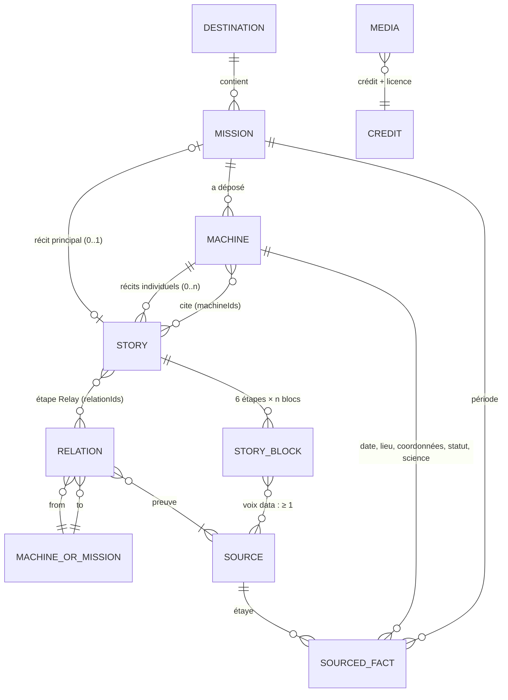

# Modèle de données — AeroReborn

> Rôle BMAD : Architect · Version 1.0 (Phase 0) · Statut : **en attente de validation**
> Exigences : DATA-001 → 006, SOURCE-001 → 005, MAP-003, STORY-001/002/007.
>
> ⚠️ **Tous les exemples JSON ci-dessous illustrent la structure.** Les valeurs entre chevrons (`<…>`) et `null` sont des emplacements à remplir **à partir de sources vérifiées**. Aucun exemple ne doit être copié tel quel dans `content/`.

## 1. Entités et relations



| Règle | Cardinalité |
|---|---|
| Une destination contient plusieurs missions | 1 → n |
| Une mission appartient à **une** destination | n → 1 |
| Une mission peut déposer plusieurs équipements | 1 → n |
| Un équipement appartient à **une** mission (sa destination est **dérivée** de la mission, jamais dupliquée) | n → 1 |
| Une mission a **0 ou 1** récit principal | 0..1 |
| Un équipement a **0..n** récits individuels | 0..n |
| Un récit peut citer des équipements d'**autres** missions (ex. récit Apollo 12 citant Surveyor 3) | n ↔ n |
| Une relation relie deux équipements **ou** missions et exige ≥ 1 source | — |
| Tout fait affiché référence ≥ 1 source | — |

## 2. Conventions

- **Identifiants** : `kebab-case` ASCII, uniques **par collection**, stables (utilisés dans les URL). Exemples de forme : `moon`, `apollo-12`, `apollo-12-lm-descent-stage`, `nssdca-1969-099a`. Jamais renommés après publication.
- **Dates** : ISO 8601, précision libre : `"1969"`, `"1969-11"`, `"1969-11-19"` (type `PartialDate`). Pas d'heure en P0.
- **Coordonnées** : degrés décimaux, `lat ∈ [-90, 90]`, `lon ∈ [-180, 180]` **est-positif** ; la convention d'origine (ex. « 0–360 E », « W positive ») est notée dans `note`.
- **Inconnu** : `null` (jamais de valeur approximative non sourcée). Un champ `null` n'est pas affiché.
- **Langue** : textes en anglais pour le MVP (OPEN-06) ; noms de champs en anglais.
- **Texte** : chaînes simples (pas de HTML). Mise en forme limitée via une convention Markdown minimale (`*emphase*`) si nécessaire — à décider en US-4.1.

## 3. Type pivot : `Sourced<T>`

Tout fait affiché est enveloppé pour rendre le sourçage **obligatoire par construction** :

```ts
type SourceId = string;

interface Sourced<T> {
  value: T;
  sourceIds: SourceId[];   // ≥ 1, toutes existantes dans sources.json
  note?: string;           // précision, convention, nuance (affichée en petit)
}
```

Un champ « fait » vaut soit `Sourced<T>`, soit `null`.

## 4. Fichiers et schémas

### 4.1 `content/destinations.json`

```ts
type DestinationId = 'moon' | 'mars';

interface Destination {
  id: DestinationId;
  name: string;                 // "Moon", "Mars"
  kind: 'natural-satellite' | 'planet';
  tagline: string;              // accroche courte (éditoriale, non factuelle)
  intro: string;                // 2 phrases max (EXPL-001)
  image: Media;
  map: {
    baseImage: Media;           // fond équirectangulaire 2:1
    centerLongitude: 0;         // méridien central du fond (doit correspondre à la projection)
  };
  order: number;
}
```

```json
[
  {
    "id": "mars",
    "name": "Mars",
    "kind": "planet",
    "tagline": "<accroche validée>",
    "intro": "<2 phrases validées>",
    "image": { "src": "/images/destinations/mars.webp", "alt": "<description>", "creditId": "<credit-id>" },
    "map": {
      "baseImage": { "src": "/images/maps/mars-equirectangular.webp", "alt": "", "creditId": "<credit-id>" },
      "centerLongitude": 0
    },
    "order": 2
  }
]
```

### 4.2 `content/missions.json`

```ts
interface Mission {
  id: string;
  name: string;                       // nom officiel
  destinationId: DestinationId;
  agency: string[];                   // ex. ["NASA"] — sourcé via sourceIds de la mission
  period: Sourced<{ start: PartialDate; end?: PartialDate | null }> | null;
  summary: string;                    // présentation courte (éditoriale, appuyée sur sourceIds)
  mainStoryId: string | null;         // 0..1 récit principal (STORY-002)
  order?: number;                     // si la date est inconnue
  sourceIds: SourceId[];              // sources générales de la mission (≥ 1)
}
```

```json
[
  {
    "id": "apollo-12",
    "name": "Apollo 12",
    "destinationId": "moon",
    "agency": ["NASA"],
    "period": { "value": { "start": "<AAAA-MM-JJ>", "end": "<AAAA-MM-JJ>" }, "sourceIds": ["<source-id>"] },
    "summary": "<présentation courte>",
    "mainStoryId": "apollo-12",
    "sourceIds": ["<source-id>"]
  }
]
```

**Granularité (OPEN-16)** : une entrée `Mission` correspond à une mission telle que référencée par NSSDCA/NASA. Le CDC formule le test T2 comme « un équipement de la *mission Spirit* », ce qui plaide pour **une mission par rover MER** (Spirit, Opportunity) ; le récit principal « Mars Exploration Rover » serait alors rattaché à l'une d'elles ou porté par un champ `programId`. **À trancher avec la piste contenu avant US-4.6.**

### 4.3 `content/machines.json`

```ts
type MachineStatus =
  | 'operational'      // encore en fonctionnement
  | 'contact-lost'     // contact perdu sans fin de mission déclarée
  | 'inactive'         // éteint / plus utilisé, en place
  | 'mission-ended'    // fin de mission officiellement déclarée
  | 'unknown';         // statut non établi par une source → affiché « Status not confirmed »

type MachineType = 'lander' | 'rover' | 'descent-stage' | 'experiment' | 'helicopter' | 'impactor' | 'other';

interface Machine {
  id: string;
  name: string;                               // nom officiel
  shortName?: string;
  missionId: string;                          // destination dérivée de la mission
  type: MachineType;
  nssdcaId?: string | null;                   // identifiant COSPAR/NSSDCA si applicable
  date: Sourced<PartialDate> | null;          // date pertinente (atterrissage, dépôt…)
  dateLabel?: 'landing' | 'deployment' | 'impact' | 'last-contact';
  locationName: Sourced<string> | null;       // ex. nom de la région
  coordinates: Sourced<{ lat: number; lon: number }> | null;   // MAP-003 : null → pas de marqueur
  status: Sourced<MachineStatus>;             // EQUIP-005 — voir règle « unknown » ci-dessous
  scienceSummary: Sourced<string> | null;     // une phrase sur la science permise
  image?: Media | null;
  storyIds: string[];                         // récits individuels (0..n)
}
```

Règle `status` : si aucune source ne permet d'établir le statut, utiliser `{ "value": "unknown", "sourceIds": [<source décrivant l'équipement>] }` ; le libellé affiché est « Status not confirmed ». L'ajout d'une valeur à `MachineStatus` = ADR.

```json
[
  {
    "id": "<machine-id>",
    "name": "<nom officiel>",
    "missionId": "<mission-id>",
    "type": "rover",
    "nssdcaId": "<id NSSDCA ou null>",
    "date": { "value": "<AAAA-MM-JJ>", "sourceIds": ["<source-id>"] },
    "dateLabel": "landing",
    "locationName": { "value": "<région>", "sourceIds": ["<source-id>"] },
    "coordinates": null,
    "status": { "value": "mission-ended", "sourceIds": ["<source-id>"] },
    "scienceSummary": { "value": "<une phrase>", "sourceIds": ["<source-id>"] },
    "image": null,
    "storyIds": []
  }
]
```

### 4.4 `content/relations.json`

```ts
type RelationType = 'method' | 'technology' | 'data' | 'knowledge' | 'inspiration';
type EntityRef = { kind: 'machine' | 'mission'; id: string };

interface Relation {
  id: string;
  from: EntityRef;           // celui qui transmet
  to: EntityRef;             // celui qui reçoit
  type: RelationType;
  transmitted: string;       // CE qui a été transmis (phrase courte)
  evidence: string;          // SUR QUOI repose le lien (jamais la seule chronologie)
  sourceIds: SourceId[];     // ≥ 1
  showOnMap: boolean;        // P1 (MAP-007), false par défaut
}
```

```json
[
  {
    "id": "<from>-to-<to>-<type>",
    "from": { "kind": "mission", "id": "<mission-id>" },
    "to": { "kind": "mission", "id": "<mission-id>" },
    "type": "technology",
    "transmitted": "<ce qui a été transmis>",
    "evidence": "<preuve documentaire>",
    "sourceIds": ["<source-id>"],
    "showOnMap": false
  }
]
```

### 4.5 `content/stories/<storyId>.json`

```ts
type StepKey = 'signal' | 'why' | 'how' | 'discovery' | 'relay' | 'your-turn';
type Voice = 'data' | 'interpretation' | 'imagination';

interface StoryBlock {
  voice: Voice;
  text: string;                  // ≤ 3 phrases (NFR-READ-001)
  sourceIds: SourceId[];         // data : ≥ 1 (bloquant) ; interpretation : recommandé ; imagination : []
  media?: Media | null;
  term?: { word: string; definition: string } | null;   // vocabulaire expliqué (CDC §1)
}

interface StoryStep {
  key: StepKey;
  title: string;
  blocks: StoryBlock[];          // ≥ 1
  relationIds?: string[];        // uniquement pour key = "relay"
}

interface Story {
  id: string;
  kind: 'mission' | 'machine';
  missionId: string;             // mission de rattachement (destination dérivée)
  machineId?: string;            // requis si kind = "machine"
  machineIds: string[];          // équipements cités (peuvent appartenir à d'autres missions)
  title: string;
  status: 'draft' | 'reviewed';  // seules les "reviewed" sont publiées (QG-SCI)
  reviewedBy?: string[];         // initiales ou rôles, pas de données personnelles de mineurs
  steps: [StoryStep, StoryStep, StoryStep, StoryStep, StoryStep, StoryStep];
}
```

```json
{
  "id": "apollo-12",
  "kind": "mission",
  "missionId": "apollo-12",
  "machineIds": ["<machine-id>", "<machine-id-surveyor-3>"],
  "title": "<titre>",
  "status": "draft",
  "steps": [
    { "key": "signal", "title": "Signal", "blocks": [
      { "voice": "data", "text": "<fait d'accroche>", "sourceIds": ["<source-id>"] }
    ]},
    { "key": "why", "title": "Why", "blocks": [ "…" ] },
    { "key": "how", "title": "How", "blocks": [ "…" ] },
    { "key": "discovery", "title": "Discovery", "blocks": [
      { "voice": "data", "text": "<résultat>", "sourceIds": ["<source-id>"] },
      { "voice": "interpretation", "text": "<portée et limites>", "sourceIds": ["<source-id>"] }
    ]},
    { "key": "relay", "title": "Relay", "relationIds": ["<relation-id>"], "blocks": [ "…" ] },
    { "key": "your-turn", "title": "Your turn", "blocks": [
      { "voice": "imagination", "text": "<question ouverte, sans hypothèse présentée comme un fait>", "sourceIds": [] }
    ]}
  ]
}
```

### 4.6 `content/sources.json`

```ts
type SourceType = 'nssdca' | 'nasa-mission-page' | 'nasa-science' | 'agency' | 'paper' | 'book' | 'other';

interface Source {
  id: SourceId;
  organization: string;      // ex. "NASA Space Science Data Coordinated Archive"
  title: string;             // titre exact de la page ou publication
  url: string;               // https
  type: SourceType;
  accessedOn: string;        // AAAA-MM-JJ (date de consultation)
  license?: string | null;   // si contenu réutilisé (image, texte)
  note?: string;             // ce que la source étaye, limites
}
```

« Éléments qu'elles étayent » (CDC §7) : calculé par **index inverse** (source → faits qui la citent) dans le chargeur, et affiché sur la page About ; pas de duplication manuelle.

### 4.7 Médias et crédits

```ts
interface Media {
  src: string;               // chemin sous /images/
  alt: string;               // "" si décoratif
  creditId: string;          // → credits.json
  aiGenerated?: boolean;     // true → mention « AI-generated » visible (CDC §7)
  width?: number; height?: number;
}

// content/credits.json
interface Credit {
  id: string;
  kind: 'image' | 'map' | 'font' | 'icon' | 'library' | 'ai-usage' | 'team';
  label: string;             // ce qui est crédité
  author: string;            // auteur / organisme
  license: string;           // ex. "Public domain (NASA media guidelines)", "SIL OFL 1.1", "MIT"
  url?: string;
}
```

## 5. Règles de validation (test d'intégrité — DATA-003)

Le test `content-integrity.test.ts` lit **le contenu réel** et échoue si :

| # | Règle | Exigence |
|---|---|---|
| V1 | Identifiant dupliqué dans une collection, ou non `kebab-case` | DATA-002 |
| V2 | `destinationId` ∉ {`moon`, `mars`} | DATA-005 |
| V3 | Référence orpheline : `missionId`, `machineIds`, `storyIds`, `mainStoryId`, `relationIds`, `from`/`to`, `creditId`, `sourceIds` | DATA-003 |
| V4 | `Sourced<T>` avec `sourceIds` vide | SOURCE-001 |
| V5 | Coordonnées hors bornes ou non numériques | MAP-003 |
| V6 | Récit sans exactement 6 étapes dans l'ordre `signal → your-turn` | STORY-001 |
| V7 | Bloc `data` sans source ; `relationIds` hors étape `relay` | STORY-007 |
| V8 | Relation sans `transmitted`, `evidence` ou source | SOURCE-005 |
| V9 | Source sans `url` https, `organization`, `title` ou `accessedOn` valide | SOURCE-003 |
| V10 | `kind: "machine"` sans `machineId` ; `mainStoryId` pointant vers un récit d'une autre mission | STORY-002 |
| V11 | Date `PartialDate` invalide ; `end` antérieur à `start` | DATA-004 |
| V12 | Média sans `creditId` ou `alt` absent | ABOUT-001, NFR-A11Y-008 |

Avertissements (non bloquants, listés dans la sortie) : source jamais citée, mission sans équipement, équipement sans `scienceSummary`, récit en `draft`.

## 6. Hors périmètre du modèle

- Aucun champ pour des objets hors Lune/Mars (Pioneer 10, etc.).
- Pas de contenu multilingue en P0 (structure à définir en P2).
- Pas de données utilisateur.
