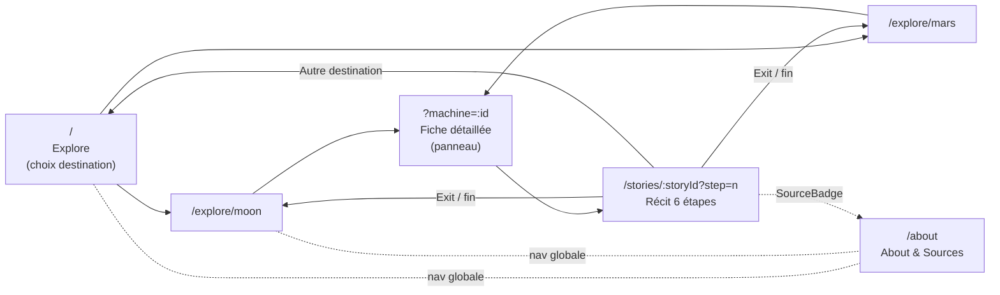
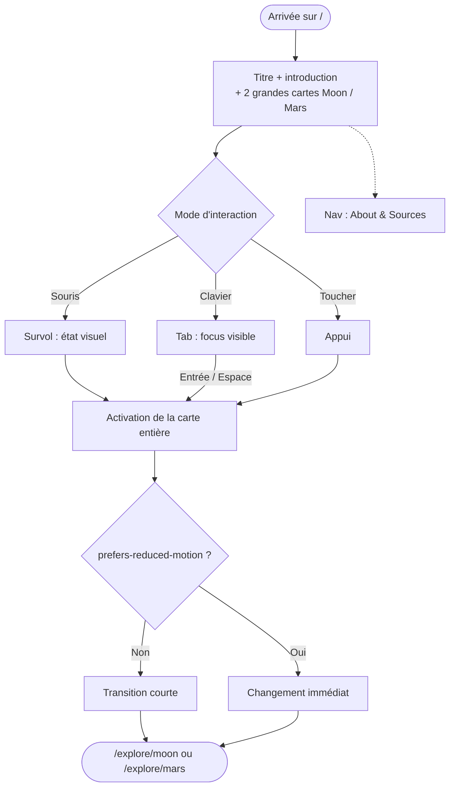
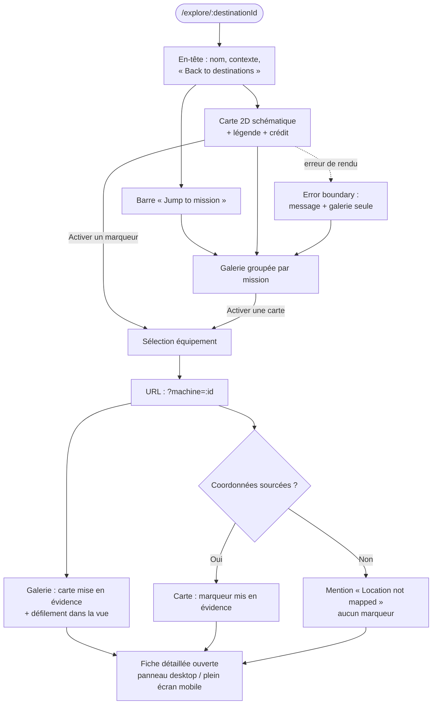
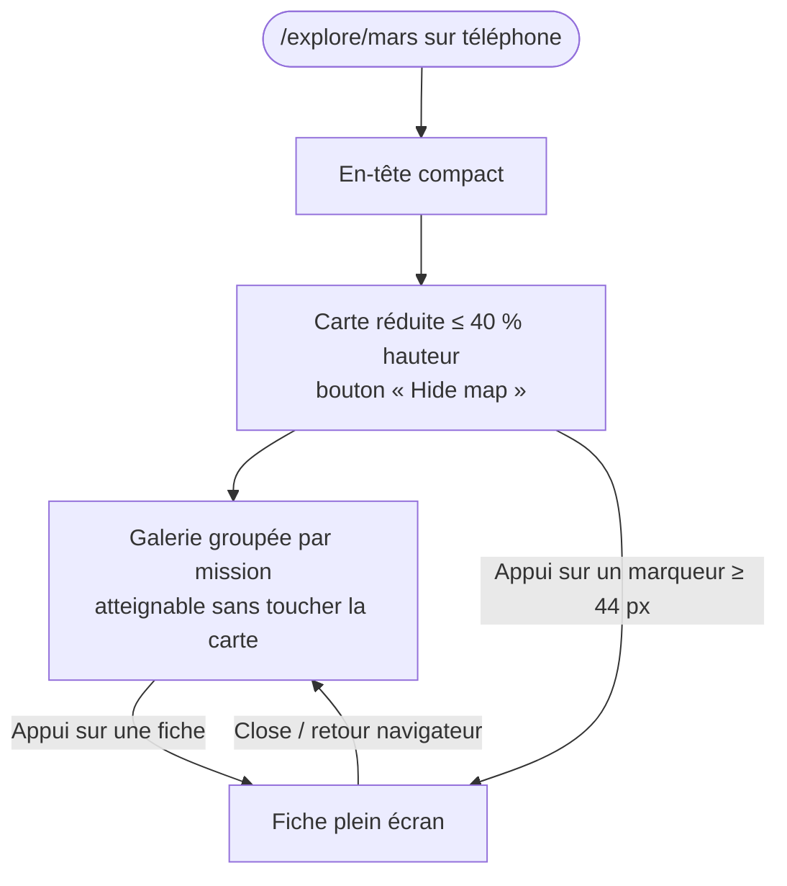
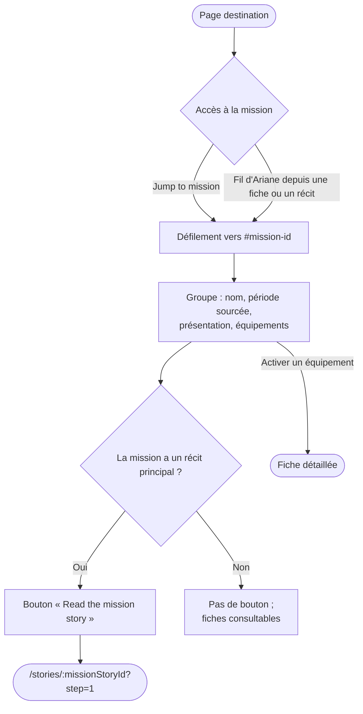
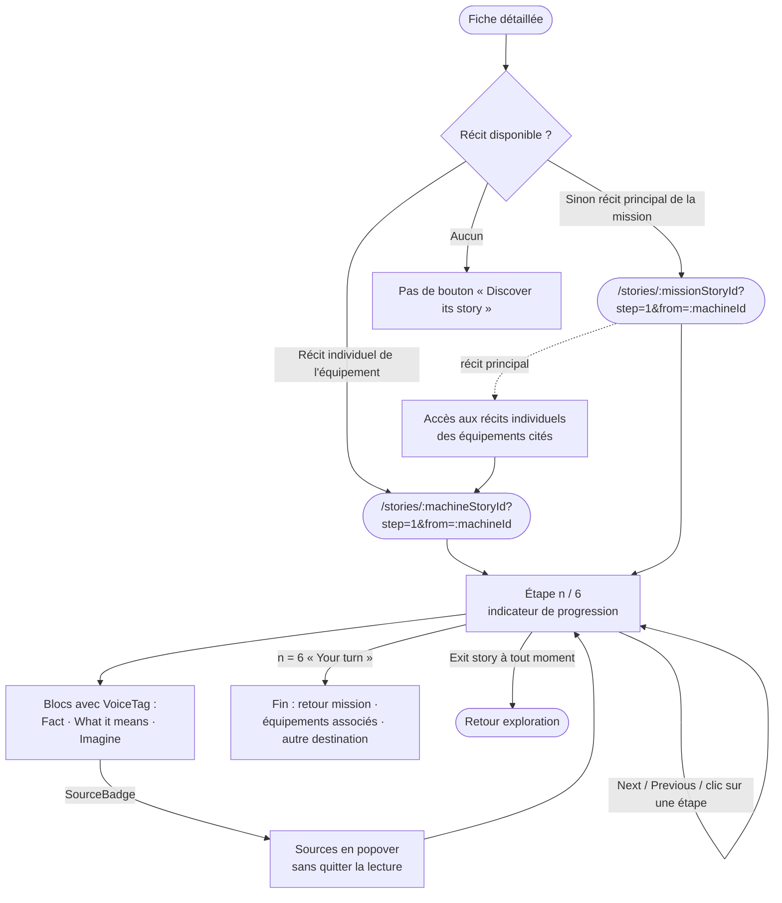
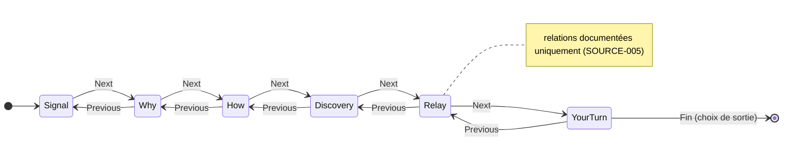
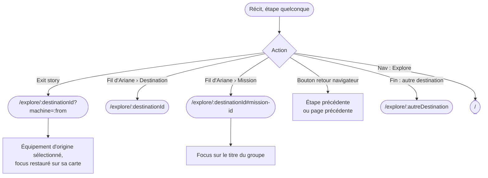

# User Flows — OrbeMoria

> Rôle BMAD : UX Designer · Version 1.0 (Phase 0) · Statut : **en attente de validation**
> Références : CDC §2–§5, [PRD.md](PRD.md). Les routes citées sont définies dans NAV-004 et [ARCHITECTURE.md §4](../architecture/ARCHITECTURE.md#4-routage-et-état-dans-lurl).

## 0. Carte des écrans

## 1. Sélection d'une destination (DEST-001 → 005)

**Points de contrôle** : aucune information révélée seulement au survol ; compteurs masqués tant que OPEN-07 n'est pas validé.

## 2. Exploration des équipements (EXPL, EQUIP, MAP, SYNC)

### 2.1 Variante mobile (< 768 px)

## 3. Consultation d'une mission

Dans le MVP, une mission n'est **pas une page** : c'est un groupe de la galerie, adressable par ancre (`#mission-{id}`), et le segment « Mission » du fil d'Ariane renvoie à cette ancre.

## 4. Consultation d'une histoire (STORY-001 → 010)

### 4.1 Séquence des six étapes

## 5. Retour vers l'exploration (NAV-002, NAV-003, STORY-006, STORY-008)

**Règle** : à chaque retour, le focus clavier est placé sur un élément pertinent (titre de page, carte d'origine) et jamais perdu en haut du document sans annonce.

## 6. Tests UX associés (CDC §10)

| Test | Flux | Réussite |
|---|---|---|
| T1 Compréhension initiale | §1 | Identifie Moon et Mars et comprend qu'il faut choisir |
| T2 Découverte « équipement de la mission Spirit » | §2, §3 | Trouvé via le groupe de mission, sans la carte |
| T3 Carte et galerie | §2 | Correspondance marqueur ↔ fiche comprise |
| T4 Récit « ce que cet équipement a permis d'apprendre » | §4 | Atteint l'étape Discovery |
| T5 Sources | §4 (SourceBadge) | Trouve une source identifiable |
| T6 Retour « liste des équipements de Mars » | §5 | Revient sans se perdre |
