# Plan d'implémentation — AeroReborn

> Rôles BMAD : Scrum Master + Architect · Version 1.0 (Phase 0) · Statut : **en attente de validation**
> Stories : [USER_STORIES.md](../product/USER_STORIES.md) · Gates : [QUALITY_GATES.md](../quality/QUALITY_GATES.md) · Décisions : [AUDIT_PHASE0.md §7](AUDIT_PHASE0.md#7-décisions-ouvertes-à-valider-par-léquipe)

## 1. Principes de pilotage

1. **Livrer un parcours complet tôt, puis l'enrichir** : un squelette navigable et déployé dès la phase 1.
2. **Deux pistes en parallèle** dès la validation de la phase 0 :
   - **Piste code** (développeurs + agent) : phases 1 → 5.
   - **Piste contenu** (rédacteurs) : catalogue sourcé (US-1.8) puis récits (US-4.5, US-4.6). C'est le **chemin critique** (risque R1).
3. **Galerie avant carte**, **pas-à-pas avant animation**, **P0 avant P1**.
4. **Petites stories vérifiables** : une story = une branche `feat/US-x.y-slug` = une PR = CI verte + relecture humaine.
5. **Validation humaine à chaque fin de phase** (gate de sortie) avant d'ouvrir la suivante.

## 2. Calendrier relatif

L'échéance du hackathon est inconnue (**OPEN-12**). Répartition proposée en part du temps de développement restant, à convertir en heures dès que l'échéance est connue :

| Phase | Part | Piste contenu en parallèle |
|---|---|---|
| 0 — Audit et structuration | (fait) | — |
| 1 — Fondations techniques | 15 % | US-1.8 catalogue Lune/Mars |
| 2 — Sélection des destinations | 10 % | US-1.8 (suite), images destinations |
| 3 — Exploration des équipements | 30 % | Relecture QG-SCI des fiches ; rédaction récits |
| 4 — Expérience narrative | 25 % | Récits US-4.5 / US-4.6 + relecture |
| 5 — Finalisation | 20 % (dont 10 % de marge) | Vérification finale, crédits |

```mermaid
gantt
    dateFormat  X
    axisFormat  %s%%
    title Répartition relative (en % du temps)
    section Code
    Phase 1 Fondations      :p1, 0, 15
    Phase 2 Destinations    :p2, after p1, 10
    Phase 3 Exploration     :p3, after p2, 30
    Phase 4 Récit           :p4, after p3, 25
    Phase 5 Finalisation    :p5, after p4, 20
    section Contenu
    US-1.8 Catalogue sourcé :c1, 0, 30
    Récits + relecture      :c2, 25, 50
    Vérification finale     :c3, 80, 15
```

## 3. Phases

### Phase 0 — Audit et structuration ✅ (en attente de validation)

- **Objectifs** : comprendre l'existant, formaliser le produit, cadrer le travail des agents.
- **Tâches réalisées** : audit du dépôt ; lecture intégrale du CDC v3 et de l'identité COSMOS ; analyse d'écart ; PRD ; user flows ; user stories ; périmètre ; architecture ; modèle de données ; ADR ; design system ; harness (CLAUDE.md, quality gates, modèle de story) ; ce plan.
- **Livrables** : `CLAUDE.md`, `docs/**` (voir CLAUDE.md §3).
- **Critères de validation (Readiness review)** :
  - [ ] L'équipe a relu et validé PRD, SCOPE, ARCHITECTURE, DATA_MODEL.
  - [ ] Décisions tranchées : OPEN-01, 02, 04, 05, 11, 13, 17 (bloquent la phase 1).
  - [ ] OPEN-12 (échéance) renseignée pour calibrer le §2.
- **Risques** : documentation non relue → agents qui improvisent. Mitigation : la phase 1 ne démarre pas sans cette validation.

### Phase 1 — Fondations techniques

- **Objectifs** : socle TypeScript typé, structuré, contrôlé automatiquement, déployé.
- **Tâches (dans l'ordre)** :

| # | Story | Tâche | Dépend de |
|---|---|---|---|
| P1-01 | US-1.1 | `<title>`, README racine, copie des PDF dans `docs/reference/` | OPEN-01 |
| P1-02 | US-1.2 | `npm ci` + **ligne de base** (lint/test/build consignés) ; migration TS strict ; scripts `typecheck` et `check` ; `.nvmrc` ; unification de `cn()` ; plugins oxlint `typescript` + `jsx-a11y` | OPEN-02 |
| P1-03 | US-1.3 | Routeur, `Layout` (header, nav, skip link, footer non-affiliation), pages squelettes, 404 ; remplacement de la page démo et de ses tests | OPEN-04, P1-02 |
| P1-04 | US-1.4 | `tokens.css`, polices COSMOS, focus global, thème sombre | OPEN-13, P1-02 |
| P1-05 | US-1.5 | `content/` (fichiers vides valides), types, chargeur + index, `content-integrity.test.ts`, fixtures, script `check:links` | OPEN-17, P1-02 |
| P1-06 | US-1.6 | Workflow GitHub Actions | P1-02 |
| P1-07 | US-1.7 | Liaison hébergeur (action humaine), `vercel.json`, URL publique | OPEN-05, P1-03 |
| ∥ | US-1.8 | **Piste contenu** : catalogue Lune/Mars sourcé | Validation phase 0 |

- **Livrables** : application squelette navigable en ligne ; CI verte ; modèle de contenu validé par test.
- **Validation** : gate « Socle vert » (QUALITY_GATES §4).
- **Risques** : versions récentes (Vite 8, React 19, Vitest 5) → incompatibilités à la migration TS (mitigation : ligne de base avant toute modification) ; liaison hébergeur dépendante d'un compte humain.

### Phase 2 — Sélection des destinations

- **Objectifs** : étape 1 du parcours complète et accessible.
- **Tâches** : US-2.1 (DestinationSelector, DestinationCard), US-2.2 (images, crédits, compteurs derrière `showCounts`), US-2.3 (Breadcrumbs, BackLink, gestion du focus au changement de route).
- **Dépendances** : phase 1 ; `destinations.json` rempli (2 entrées, images créditées).
- **Livrables** : `/` finalisée ; navigation globale et fil d'Ariane opérationnels.
- **Validation** : gate « Parcours étape 1 » ; test UX T1 informel.
- **Risques** : images non libres de droits → n'utiliser que des médias dont la licence est vérifiée (QG-LEGAL).

### Phase 3 — Exploration des équipements

- **Objectifs** : étape 2 complète, galerie d'abord, carte ensuite, synchronisées.
- **Tâches (dans l'ordre)** :
  1. US-3.1 — galerie groupée par mission (fonctionne seule : **plan de secours livré en premier**).
  2. US-3.2 — MachineCard, MachineDetail (panneau/plein écran), StatusBadge, SourceBadge.
  3. US-3.5 — barre « Jump to mission » (si OPEN-14 = P0).
  4. US-3.3 — carte : projection, fond, marqueurs, regroupement de sites, légende, error boundary.
  5. US-3.4 — synchronisation carte ↔ galerie.
  6. US-3.6 — passe mobile.
- **Dépendances** : US-1.5 ; US-1.8 au moins partiellement validé (les composants sont développés sur **fixtures** en attendant) ; OPEN-15 pour le fond de carte.
- **Livrables** : `/explore/moon` et `/explore/mars` complètes.
- **Validation** : gate « Parcours étape 2 » ; tests UX T2, T3 informels.
- **Risques** : coordonnées à conventions hétérogènes (Mars est/ouest) ; superposition de marqueurs ; le contenu arrive tard → fixtures + affichage progressif.

### Phase 4 — Expérience narrative

- **Objectifs** : étape 3 complète avec au moins un récit relu par destination.
- **Tâches** : US-4.1 (moteur, StoryPage, lazy load), US-4.2 (progression, Previous/Next, Exit, historique), US-4.3 (VoiceTag), US-4.4 (SourceBadge dans le récit), US-4.7 (fin de récit, liens vers récits individuels), US-4.5 et US-4.6 (contenu, piste contenu).
- **Dépendances** : phase 3 (fiche → récit) ; OPEN-08, OPEN-16 ; `relations.json` pour l'étape Relay.
- **Livrables** : récits publiés (`status: "reviewed"`).
- **Validation** : gate « Parcours étape 3 » ; tests UX T4, T5, T6 informels.
- **Risques** : relecture scientifique qui révèle des erreurs tardives → relire chaque étape dès sa rédaction ; tentation d'animer (OPEN-10) → hors P0.

### Phase 5 — Finalisation

- **Objectifs** : produit public, stable, accessible, vérifié, démontrable.
- **Tâches** : US-5.1 (About & Sources complète), US-5.2 (THIRD_PARTY_LICENSES), US-5.3 (audit a11y + responsive, corrections), optimisation images et budget JS, US-5.4 (QG-SCI + QG-LINKS sur 100 % du contenu), US-5.5 (release, QG-SMOKE, tests UX du CDC §10 avec ≥ 3 adultes, répétition de la démo et du pitch, plan de secours « galerie seule »).
- **Dépendances** : phases 2–4.
- **Livrables** : URL publique finale ; rapport de vérification ; script de démo.
- **Validation** : gate « Release ».
- **Risques** : corrections de dernière minute qui cassent la build → gel du code annoncé (seules les corrections bloquantes après le gel), CI obligatoire.

## 4. Plan de réduction si le temps manque (dans cet ordre)

1. Abandonner toute tâche P1 en cours.
2. Remplacer le regroupement automatique de sites par un regroupement manuel par mission.
3. Ne publier qu'**un** récit complet par destination (minimum STORY-010).
4. Masquer la carte (feature flag) et livrer la **galerie seule** — plan de secours exigé par le CDC §9.

Ne **jamais** réduire : sources, séparation des voix, accessibilité clavier, mention de non-affiliation.

## 5. Rituels (adaptés au hackathon)

| Moment | Contenu | Durée |
|---|---|---|
| Début de phase | Vérifier la DoR des stories de la phase, assigner piste code / contenu | 10 min |
| Chaque PR | CI verte + relecture humaine + rapport de vérification | — |
| Fin de phase | Gate de sortie, démo interne, mini-rétrospective (garder / changer) consignée en bas de ce fichier | 15 min |

## 6. Avancement de la phase 1 (branche `feat/phase1-foundations`)

| # | Statut | Détail |
|---|---|---|
| P1-01 | 🟡 | Nom AeroReborn, README racine faits ; PDF de référence pas encore copiés |
| P1-02 | ✅ review | TypeScript strict front **et** back, `typecheck`/`check`, `.nvmrc`, `cn()` unique, oxlint `typescript` + `jsx-a11y` |
| P1-03 | ✅ review | react-router, Layout (skip link, nav, footer), pages squelettes, 404, page d'erreur |
| P1-04 | ✅ review | Thème COSMOS + polices |
| P1-05 | ⛔ bloquée | OPEN-17, OPEN-18 |
| P1-06 | ✅ review | CI matrice frontend/backend (à confirmer au premier push) |
| P1-07 | ⛔ bloquée | OPEN-05, OPEN-18 |
| ajout | ✅ review | Internationalisation (ADR-015) ; backend TypeScript testé (ADR-016) |

Détail et sorties de vérification : [stories/PHASE1-BATCH-1.md](stories/PHASE1-BATCH-1.md).

## 7. Journal des rétrospectives

| Phase | Date | À garder | À changer |
|---|---|---|---|
| 0 | — | — | — |
